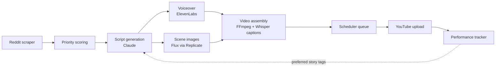

# Automated Short-Form Video Pipeline

A Python system that runs a YouTube Shorts channel end to end: it finds and ranks Reddit stories, writes a script with an LLM, generates narration and scene images, assembles a captioned vertical video, uploads it on a schedule, and feeds performance data back into what it picks next.

## How it works



| Stage | Module | What it does |
|---|---|---|
| Sourcing | `reddit_scraper.py` | Pulls recent r/AITA posts, filters by age and upvotes, skips anything already used |
| Ranking | `reddit_scraper.py` | Scores posts by upvotes plus weighted keyword tiers (conflict and betrayal themes up, workplace stories down) |
| Scripting | `script_generator.py` | Turns a post into a ~80-second script, scene list, title, hashtags, and pinned comment as structured JSON |
| Narration | `tts_engine.py` | Generates the hook and body as separate voice segments, then joins them with FFmpeg |
| Visuals | `image_generator.py` | Generates 12 scene images per video |
| Assembly | `video_assembler.py` | Builds the 9:16 video with word-timed captions (Whisper) and text overlays |
| Scheduling | `scheduler.py`, `main.py` | Queues videos into fixed daily posting slots and pre-generates two hours ahead |
| Upload | `uploader.py` | Publishes through the YouTube Data API and pins an engagement comment |
| Feedback | `performance_tracker.py` | Every 30 uploads, pulls analytics and identifies which story types perform best |

## Engineering details

- **Isolated generation.** Each video is built in a separate subprocess with a timeout, so a crash or hang in image, audio, or video tooling can't take down the scheduler.
- **Single-instance lock.** A file lock prevents two copies of the bot from running and double-posting.
- **Account safety check.** On startup the bot confirms its credentials belong to the expected channel and refuses to run otherwise.
- **Double-post guard.** A 30-minute cooldown and a catch-up check handle the case where generation fails and has to be retried after its slot.
- **Fallback content.** If the eligible Reddit pool runs dry, the worker generates an original premise instead of stalling.
- **Dry-run mode.** `DRY_RUN=true` (the default) runs the full pipeline without uploading, so output can be reviewed first.
- **Alerts.** Uploads, generation starts, and failures are sent to Telegram.

## Results

- **10,000+ views**
- **82% average percentage viewed** on ~80–100 second videos

## What I learned

- **Retention and engagement are different problems.** Videos held viewers well, but comment rates stayed low, which led to changes in how scripts end and what gets pinned.
- **One viral video can distort the signal.** A single outlier spiked daily views and then fell off, so decisions are based on averages across uploads rather than individual hits.
- **Content selection matters more than production.** The keyword-priority scorer had a bigger effect than visual tweaks, which is why ranking became its own step.

## Stack

Python · Anthropic Claude API · ElevenLabs · Replicate (Flux) · FFmpeg · OpenAI Whisper · YouTube Data API v3 · Telegram Bot API

## Running it

```bash
cp .env.example .env        # add your own API keys
pip install anthropic elevenlabs replicate google-api-python-client google-auth-oauthlib python-dotenv pillow requests openai-whisper
python main.py --once       # one cycle (dry run by default)
python main.py              # run on schedule
```

Requires FFmpeg on your PATH and a Google OAuth client file for the YouTube API.
